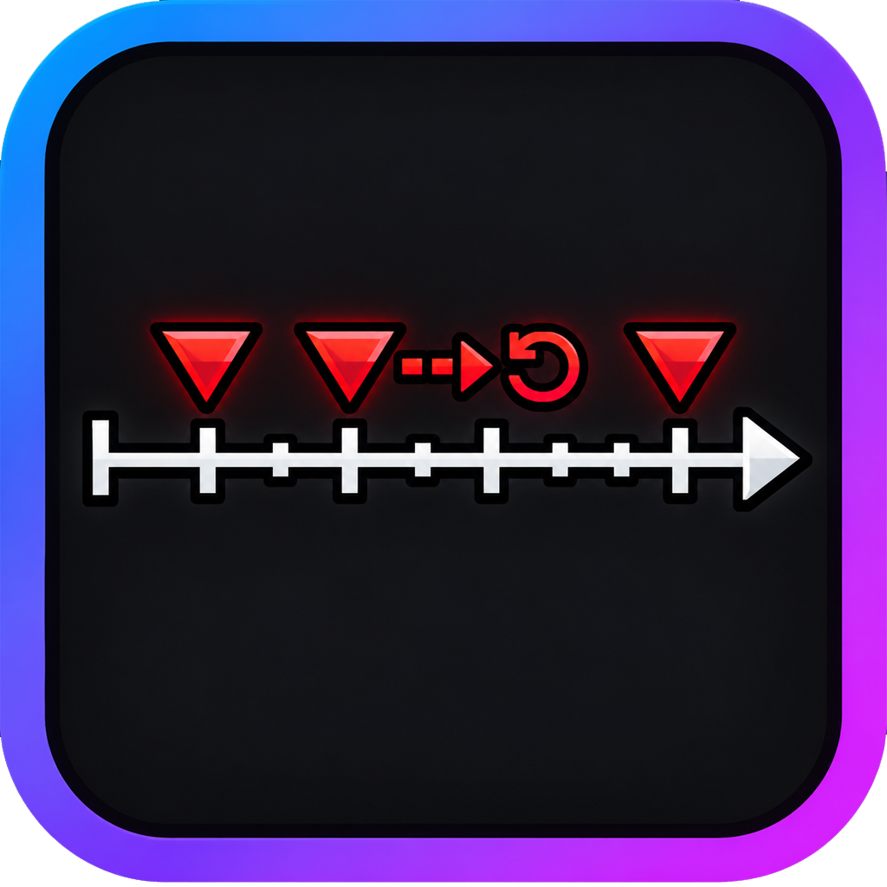

<div align="center">



# EarlyBuffer

**Click early. Still live.**


Timing assist for Geometry Dash **2.2081** — not an autoplayer.<br/>
You still click. EarlyBuffer only holds a slightly early jump and fires it on the first physics tick a shadow sim still calls safe.

<br/>

<a href="https://github.com/ToldByNun/earlybuffering-gd/releases"></a>
<a href="https://ToldByNun.github.io/earlybuffering-gd/"></a>


<a href="LICENSE"></a>

<br/>

<a href="https://github.com/ToldByNun/earlybuffering-gd/releases"><strong>Download</strong></a>
&nbsp;·&nbsp;
<a href="https://ToldByNun.github.io/earlybuffering-gd/"><strong>Docs</strong></a>
&nbsp;·&nbsp;
<a href="https://discord.gg/QJuTDkmPcf"><strong>Discord</strong></a>
&nbsp;·&nbsp;
<a href="https://github.com/ToldByNun/earlybuffering-gd/issues"><strong>Issues</strong></a>

<br/>

<strong>Not on the Geode Index.</strong> Install from <a href="https://github.com/ToldByNun/earlybuffering-gd/releases">GitHub Releases</a> only.<br/>
<strong>Last 2.2081 line</strong> — v1.6.1 does not support newer Geometry Dash builds.

</div>

---

## Install in 3 steps

1. Install [Geode](https://geode-sdk.org/) for **GD 2.2081**.
2. Download the multi-platform `.geode` from [Releases](https://github.com/ToldByNun/earlybuffering-gd/releases).
3. Put it in your Geode mods folder and restart GD.

**Also need:** dependency **geode.node-ids** ≥ v1.23.3 (that one can still come from the Index).

| You play on… | Make sure the package contains… |
|---|---|
| Windows | `audesign.earlybuffer.dll` |
| Android | `audesign.earlybuffer.android64.so` |
| iOS | `audesign.earlybuffer.ios.dylib` |

A Windows-only local build will **not** load on phone. Use a merged / release package. Details: [`INSTALL.md`](INSTALL.md).

---

## What it does (20 seconds)

1. You jump a little **too early**.
2. EarlyBuffer **holds** that press for a short window.
3. A tiny shadow copy of the game asks: “is this tick still safe?”
4. **Yes** → it fires your jump there. **Nothing better** → your normal click goes through.

It does **not** invent clicks. It does **not** rewind late clicks. Assist, not bot.

---

## Modes at a glance

| Mode | What you get |
|---|---|
| **Live** | Plans each click with a shadow sim. Optional Adaptive Prediction Planner. |
| **Hybrid** | Bake window when near + live verify, otherwise Live. |
| **Replay** | Timing windows from an imported macro bake. |
| **BruteForce** | Serial search bake into a timing map. |

Also built in:

- **Safe Mode** — when assist is on (or has touched a run), progress / bests are not saved as legit clears
- **Scope gates** — platformer hard-off; practice / startpos / percent window; assist-off ranges
- **Orbs / Wave / CPS budgets** — algorithm limits you can tune
- **Learning** — optional per-level bias (off by default)
- **Trigger World Bake** — cache static movers so the shadow sim can collide them
- **Cloud Configs** — browse / rate / install / share community settings packs (classic Geode popup in v1.6.x)
- **Lag Warning** — once-per-level ImGui card when a Live click feels hitchy (UI → Notifications)

Full planner & settings contract: [`docs/assist_reference.md`](docs/assist_reference.md) · player docs: [site](https://ToldByNun.github.io/earlybuffering-gd/)

---

## Desktop settings (v1.6.1)

On desktop, EarlyBuffer ships an ImGui settings shell (sidebar + tabs):

**Main → Assist → Learn → Bake → Modes → Visual → UI → Keys | Dev**

- Accent Color drives the purple theme + sidebar wave
- Modes icon bar (Cube → Swing) with per-mode cards
- Assist Off Ranges as an editable list
- Styled in-shell confirm / info modals

Open Geode → EarlyBuffer → Settings, or pause → **EB**.

---

## Cloud Configs

**Settings → Learn → Config → Cloud Configs** (or classic Assist actions below Import Config).

- Browse / search packs, sort by downloads or rating
- Install applies settings (keybinds + Dev Lab keys stay)
- Share exports your current config for review
- Cached / seed packs work offline

See [Cloud Configs](docs/cloud_configs.md).

---

## Quick facts

| | |
|---|---|
| Mod ID | `audesign.earlybuffer` |
| Version | **1.6.1** |
| Target | GD **2.2081** / Geode **5.11.1+** |
| Platforms | Windows · macOS · iOS · Android |
| License | [MIT](LICENSE) |
| Docs | [ToldByNun.github.io/earlybuffering-gd](https://ToldByNun.github.io/earlybuffering-gd/) |
| Discord | [Invite](https://discord.gg/QJuTDkmPcf) |

---

## Build (maintainers)

```bash
# Needs GEODE_SDK + C++23 (MSVC on Windows)
geode build --config RelWithDebInfo
```

CI builds all platforms via [`.github/workflows/multi-platform.yml`](.github/workflows/multi-platform.yml).  
Ship packages must pass `python tools/geode_package_check.py … --forbid-zstd`.

---

## Support & ethics

- This mod **assists inputs**. Using it on rated / online content may break community norms or RobTop’s rules — keep **Safe Mode**, use practice, and use your own judgment.
- Bugs: [GitHub Issues](https://github.com/ToldByNun/earlybuffering-gd/issues) with GD / Geode / platform / steps (crashlog if any).
- Changelog: [`changelog.md`](changelog.md)

## Contributing

See [`CONTRIBUTING.md`](CONTRIBUTING.md).

## Credits

- Maintainer / design / engineering: **Audesign** ([ToldByNun](https://github.com/ToldByNun))
- Built on [Geode](https://geode-sdk.org/) and Geometry Dash bindings
- Replay import: [GDReplayFormat](https://github.com/maxnut/GDReplayFormat)

Product direction and review are human-owned. AI coding tools were used as a drafting aid; every shipped line was reviewed and playtested / self-checked.

Working-tree names *frirecracker* / *EarlyGrace* refer to early development — the published mod is **EarlyBuffer**.
